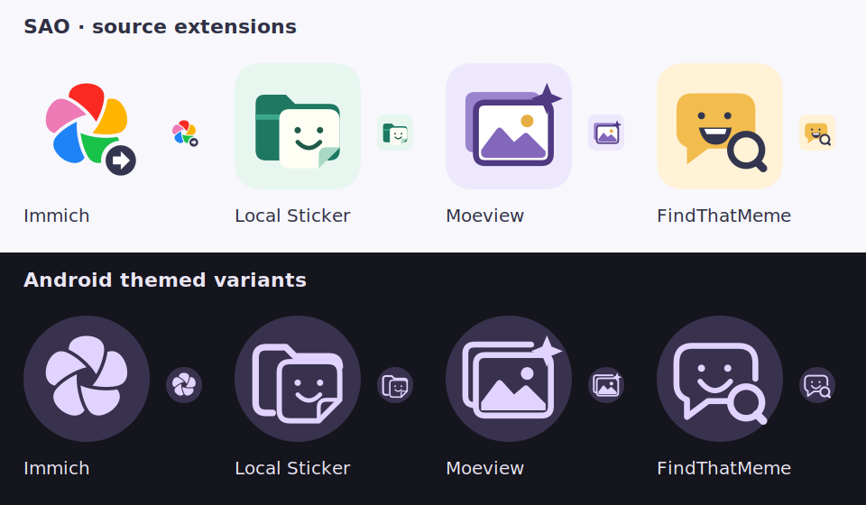

# SAO extensions

First-party media sources for [SAO](https://github.com/nijuyonkadesu/SAO). Each Android APK owns its profiles, credentials and source-specific work. SAO owns browsing, caching and delivery to chats.

| Icon | Module | Source |
| --- | --- | --- |
|  | immich-extension | Immich servers and named accounts |
|  | local-extension | Local folders, albums, tagging, OCR and Context search |
|  | moeview-extension | Supported image boards |
|  | findthatmeme-extension | Public keyword/caption meme search |
|  | googlephotos-extension | Experimental Google Photos source with Vector-assisted connection, Context and Text matches |

[Google Photos setup and verification limits](docs/googlephotos-source.md). Enable **SAO Google Photos** for the official Photos app in Vector; Google account authentication requires live device verification. This adds no Google SDK, Python runtime or new runtime dependency, and needs no SAO host update.

The APK and catalog icons share one vector source; Android also receives adaptive and monochrome variants. [Artwork and attribution](THIRD_PARTY_NOTICES.md#extension-artwork). No raster assets or runtime dependencies are added to the APKs.



## Build

Use JDK 21 and Android SDK 37. The Gradle wrapper downloads the versioned source SDK from public SAO Release assets through Gradle's standard Ivy support. A SAO checkout or GitHub account is not needed to build.

```sh
./gradlew :immich-extension:assembleDebug :local-extension:assembleDebug :moeview-extension:assembleDebug :findthatmeme-extension:assembleDebug
./gradlew :googlephotos-extension:assembleDebug
```

The `repo` branch contains the generated public catalog and download page. Installable APKs live in GitHub Releases. Each source has an independent version and release. CI is deferred; publishing is manual.

## History

Extracted from SAO at `e1d9bf31f2175ffe803396a03951e54156b271d6`, preserving 46 relevant commits, authors and messages. The original SAO history is unchanged. `docs/history-map.txt` maps original commit IDs to filtered IDs. The extraction includes client libraries, source settings resources, third-party notices and source-specific documentation.

The shared `source-api` and `source-settings` SDK remains maintained in SAO and is consumed as versioned libraries here. Credentials, installed package IDs and APK signing identities are preserved during the move.

## Manual releases

Set `SAO_RELEASE_KEYSTORE` to the release keystore path, `SAO_RELEASE_ALIAS` to its alias, and `SAO_RELEASE_STORE_PASSWORD` in your environment. `SAO_RELEASE_KEY_PASSWORD` defaults to the store password. Never commit credentials or the keystore. Then prepare optimized, release-signed downloads and the catalog:

```sh
./gradlew :immich-extension:assembleRelease :local-extension:assembleRelease :moeview-extension:assembleRelease :findthatmeme-extension:assembleRelease
./gradlew :googlephotos-extension:assembleRelease
python3 tools/release.py
```

Output is in `build/distribution`, with Local Sticker split by ABI. The tool verifies the official publisher certificate before preparing the stable catalog. Retain that certificate for in-place updates; locally debug-signed installations cannot be replaced by a differently signed release.

After tests and a source commit pushed to main, `python3 tools/release.py --publish` uploads immutable per-extension releases with gh. Use `--notes-dir /path/to/notes` to supply `<extension-id>.md` notes for every source. A published version with different bytes is refused; increment its version instead. Then copy `build/distribution/catalog/` into a checkout of the `repo` branch and commit/push it. APKs are published before catalog pointers. No workflow/CI is required.

The SDK and reference-test dependencies use Gradle's built-in Ivy descriptors to resolve public Release assets, including transitive dependencies. No custom downloader, GitHub credentials or sibling checkout is required.

Migration validation: all four standalone debug and optimized release builds pass; 57 extension JVM tests and 38 Android checks pass, including native local indexing/vector lifetime, original files, idle behavior and the host's FindThatMeme settings/search flow. Lint has zero errors. Instrumentation uses synthetic media and local mock servers.


### Shared SDK

Source API and the shared Views settings library use SDK 1.2.0, resolved from the public `source-sdk-1.2.0` release. For SDK development, stage both libraries from an adjacent SAO checkout, then build this repository normally:

```sh
cd ../SAO
./gradlew :source-api:publishSourceSdkPublicationToSourceSdkRepository :source-settings:publishSourceSdkPublicationToSourceSdkRepository
cd ../SAO-extensions
./gradlew assembleRelease
```

This writes an AAR/Ivy descriptor under SAO/build/source-sdk; it does not upload anything. A different location can be supplied with `-PsaoSdkRepo=/absolute/path/to/source-sdk`. First-party APKs share the same settings colors, chip roles, icons and typed choice binding through that versioned library; credentials and API work remain extension-owned. Distributed APKs use the release variant, with R8 minification and resource shrinking enabled in all five modules. Debug APKs are for instrumentation and are not distribution artifacts.

Translations: [Translate SAO on Crowdin](https://crowdin.com/project/sao-share-arts-by-overlay) · [Contributor guide](docs/translations.md).
